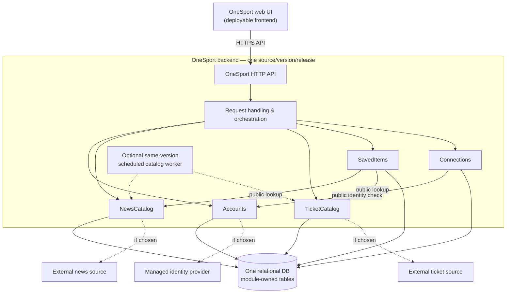

# ADR-0001: OneSport application and deployment architecture

- **Date:** 2026-10-29
- **Status:** **ACCEPTED — ARCHITECTURE DIRECTION ONLY; DETAILED IMPLEMENTATION PENDING REVIEW**
- **Accepted direction:** **Option B — modular monolith**; a relational database and domain-owned modules form the documented baseline for design review, not approval of exact implementation.
- **Decision acceptance:** User explicitly accepted Option B on 2026-10-29; formal implementation reviewers/approvers have not been identified
- **Requirements source:** [OneSport system description and US01–US24](../OneSport.txt)
- **Discussion, comparison and actual feedback:** [OneSport architecture discussion](discussion.md)
- **Workflow:** [Architecture discussion and ADR skill](../SKILL.md)
- **Revision:** 0.4 — explicit user acceptance of architecture direction recorded; detailed design remains reviewable

> **Acceptance boundary (2026-10-29):** The user explicitly chose **Option B, the modular monolith, as OneSport’s architecture direction**. This accepts the high-level architectural shape established in the three-option discussion; it **does not approve every proposed module API, data boundary exception, deployment configuration, provider, framework, schema, concurrency mechanism, security policy detail or operational plan**. The detailed ADR is open to review and revision. Integration sources, team skills, workload, operations constraints and stakeholder privacy policies remain unresolved.

## 1. Context, constraints, assumptions and drivers

OneSport is intended to combine recent sports news, information about upcoming event tickets, personal collections, account management and friend relationships. The source supplies 24 stories but no technology stack, scalability target, compliance policy, operations budget, team structure or confirmed external integration. On 2026-10-29 the user also stated there is **no established backend preference**; this does not establish anything about individual skills or an existing codebase.

### Confirmed requirements from the source

| User stories | Required capability | Proposed module owner |
|---|---|---|
| US01–US06 | Sign up/in/out; access profile; delete account; change email/password | Accounts |
| US07–US08 | Browse recent sports news and filter by country, including Italy | NewsCatalog |
| US09–US10, US20 | Save, remove and list favourite news | SavedItems, using NewsCatalog references |
| US11–US12 | Browse available upcoming ticket listings and filter by country, including Italy | TicketCatalog |
| US13–US14, US21 | Save, remove and list tickets of interest | SavedItems, using TicketCatalog references |
| US15 | Clear saved news and tickets | SavedItems |
| US16–US18, US22–US24 | Send, inspect, accept or decline requests; list/remove friends | Connections |
| US19 | Look up another user by email and view details | Accounts directory API, used by Connections/UI |

The original narrative describes a ticket-purchasing destination, while **no** story defines checkout, payment authorization, inventory holds, ticket issuance, refunds or cancellation. **On 2026-10-29 the user confirmed that release 1 supports ticket browsing and saving only, with no purchase flow.** Thus neither on-site nor redirected checkout, payment, reservation, order handling or ticket issuance belongs to release 1. US13’s “purchase them later” explains why a user saves listings; it does not authorize implementing purchases now. This confirmed scope decision is additional to the [source user stories](../OneSport.txt), not an inference from them. Likewise, the source requires country filtering for Italian items but does not define global country coverage.

### Known constraints and architectural quality needs

- Confirmed: sports information should be up to date, but no freshness target is defined; there are user-controlled private records and social relationships.
- Architectural correctness needs inferred from the listed actions (design obligations rather than stakeholder-confirmed nonfunctional requirements): enforce identity and ownership server-side, prevent duplicate saved items/friendships, atomically update friendship state, avoid exposing unrestricted email-based account lookup, and handle partial account removal and external errors explicitly.
- Confirmed by user during review: **no established backend preference**. This removes a preselected backend/vendor as a decision constraint, but does not prove the team lacks relevant experience or an existing codebase.
- Unknown: hosting/provider choice, stack, actual team skills, existing codebase status, expected scale, team organization, data sources, provider SLAs, latency/availability/recovery objectives, budget, privacy/retention and legal terms. Do **not** infer these constraints.
- **Planning assumptions, not confirmed:** OneSport will expose a web UI and server API; content may come from external news/ticket feeds; a relational store will be a good fit for users, requests, friendship edges and saved associations; there is no independently managed production service estate already in place. **Release-1 no-purchase scope is confirmed, not a planning assumption.**

### Decision drivers

1. Deliver all 24 specified stories with comprehensible rules and privacy protection.
2. Make friend request and saved-item state changes correct under duplicates and concurrency.
3. Avoid unnecessary operations/distributed coordination without evidence for it.
4. Preserve clear module boundaries and a viable migration path as requirements mature.
5. Permit managed infrastructure without coupling *application structure* to a particular hosting pattern.
6. Select from architectural evidence, because the team states **no backend preference**; avoid assuming that any vendor is familiar or that all vendors are equally quick.

## 2. Accepted architecture direction and rationale

**Accepted direction: OneSport will use Option B, a modular monolith.** The proposed realization is one backend application exposing an HTTP API, a **relational database** with module-owned tables/migrations, and explicit public interfaces between internal modules. The backend has a **single coordinated release unit**. This describes the selected option’s architectural shape; detailed module contracts, deployment topology, specific database engine and hosting choices **remain subject to review**. Web UI builds may be deployed separately under API compatibility rules. A catalog worker is **optional**, only if source/freshness needs require one, and would share the backend code/version and release ownership rather than become an independently deployed microservice.

The user accepted B following an assessment that its single-database transaction scope suits OneSport’s friend-request transitions, duplicate prevention, saved references and account cleanup better than introducing independently deployed databases without a demonstrated need. **No established backend preference** was supplied, so neither a BaaS speed advantage nor a specific framework is presumed. The stories do not establish independent product teams, separate availability commitments or measured scaling hotspots. A managed database and managed application hosting remain possible; **no hosting choice has been accepted**.

The confirmed release-1 scope **excludes any purchase flow**, so Orders/Payments, inventory holds, ticket issuance and purchase-specific workflows are not part of the current architecture. If product scope changes in a later release, review data ownership, third-party integration, transaction/reconciliation guarantees and this ADR before designing those workflows.

### Direction-level decision and proposed design boundaries (details pending review)

- **Accepted architectural principle:** one modular backend with explicit domain boundaries and a common backend release. **Proposed module decomposition for detailed review:** Accounts, NewsCatalog, TicketCatalog, SavedItems and Connections, with a thin API/workflow layer.
- **Proposed communication rule:** synchronous, in-process calls through public module APIs; the UI communicates with a server API, and future external providers connect through owning catalog adapters, never other modules directly. Concrete interfaces and checks require review.
- **Baseline persistence approach for review:** one relational database with logically module-owned data and transaction support for local invariants; direct cross-module repository/table access is prohibited except specifically reviewed constraints. Exact schemas, ownership exceptions and migration plan remain undecided.
- **Accepted release-model principle:** one coordinated backend source/version/release, rather than independently deployed domain microservices. **Proposed runtime:** API plus relational DB; optional same-version worker if ingestion needs one; no queue, cache, message bus or extra service is mandated.
- **Required design safeguards for review:** server-side authorization, uniqueness/idempotency, atomic friendship transitions, safe account deletion, and explicit handling of unavailable external data. Mechanisms are deferred; these guarantees must be preserved.

## 3. Concrete responsibilities, interfaces and enforcement

| Module | Owns data and rules | Example public operations; other modules cannot reach internal repository/table |
|---|---|---|
| **Accounts** | User identity mapping, profile, credential/authentication adapter, account status, account deletion progress and directory disclosure rules | `currentUser`, `updateCredentials`, `getPermittedProfile`, `findUserByEmail`, `assertActiveUser`, `beginDelete` |
| **NewsCatalog** | News article metadata, provenance, country classification, feed refresh and article lookup | `listRecent(country?)`, `getArticle(id)`, `refreshNews` (if external feed exists) |
| **TicketCatalog** | Event/listing metadata, source IDs, country and displayed freshness/availability information (if provided); **no** checkout, reservation or purchasing inventory | `listUpcoming(country?)`, `getTicketListing(id)`, `refreshListings` (only if a source/refresh need is confirmed) |
| **SavedItems** | Per-user saved-news and saved-ticket-listing references, not purchases, orders, paid entitlements or reservations | `save(user, kind, id)`, `remove`, `list`, `clear(user, scope)` |
| **Connections** | Directed requests, acceptance/decline state, canonical undirected friendship edges, friend list | `requestFriend`, `listRequests`, `accept`, `decline`, `removeFriend`, `listFriends` |
| **API / workflows** | HTTP contract, request validation, composition, authorization context and cross-module coordination; **no domain tables of its own** except explicitly designated orchestration records owned by Accounts | HTTP handlers, `deleteAccountWorkflow`, assembled saved-item/friend views |

**Allowed dependencies:** API/workflow layer → public operations of any domain; SavedItems → public lookup/read operations of NewsCatalog and TicketCatalog; Connections → minimal public Accounts identity/status operations; catalogs → their own provider adapters. Module internals must not import API code or the internals of another domain. No module may directly query or write another domain's tables. Cross-module dependencies must form a directed acyclic graph. User identity is passed as an authenticated principal from the API layer, not trusted from client-provided `user_id` values.

**Data and migration enforcement:** each module owns its tables, repository code and migrations. Cross-module foreign keys or coordinated constraints, when indispensable in the same database, require a documented exception reviewed by both owners; they do not grant arbitrary cross-module SQL access. For saved-item and social references to users, agree on referential integrity and deletion ordering before initial migrations. Plan static architecture/import-rule checks in CI, module-level unit tests, contract tests for public interfaces, database constraint tests, and integration tests for prohibited cross-module repository access. These are **planned**, not already implemented or passing.

**Representative implementation paths:**

- **Save ticket listing:** authenticated request → SavedItems public operation → TicketCatalog lookup (when validation is available) → one transaction inserting a unique `(user, item-kind, canonical-item-id)` association. A save records interest, **not** a purchase, reservation, inventory guarantee or checkout continuation. Repeated saves return the existing state without duplicates. A later missing/expired listing is represented according to a policy to be clarified, not falsely displayed as available.
- **Accept friend request:** authenticated recipient → Connections.accept(request ID, recipient ID) → verify recipient and pending state → in one database transaction transition the request and insert a uniquely keyed, unordered friendship pair. Prevent self-friending and duplicate or conflicting requests. Concurrent accepts/reciprocal requests must converge to no more than one friendship; behavior of a redundant request is an API contract detail finalized before implementation.
- **Clear saved items:** one SavedItems-owned transactional operation removes both news and ticket references for the authenticated user if US15 is confirmed to mean both. It does **not** delete shared news/ticket catalog records.
- **Delete account:** Accounts first makes the account unable to perform authenticated actions; a controlled workflow calls SavedItems and Connections public deletion/cleanup operations, coordinating local DB updates in a transaction or recoverable staged workflow while preserving module rules. If an external identity system is chosen, its deletion/revocation is **not** atomically committed with the local DB; record durable state, use idempotent retries and make completion/recovery observable. Exact retention and deletion obligations must be defined with stakeholders before release; do not claim that deleting the primary row necessarily deletes backups or external records.

## 4. Deployment model and communication

- **Processes:** at minimum an API process and the DB; web assets may be static or separately hosted. A scheduled job is not prescribed without source/freshness requirements. If needed, it may run independently *as a process* with separate resource allocation but shares the backend artifact, version and release ownership.
- **Ownership and communications:** all backend domains execute in-process; the DB is physically shared but access is constrained by domain ownership. Only adapters reach potential external sources/identity. No network calls between domain modules.
- **Deployment coordination:** backend modules deploy together. Database migrations are reviewed and ordered for rolling/rollback compatibility, especially for shared foreign keys and account cleanup. Frontend releases respect API contracts. A frontend/UI outage or API process failure may affect all backend features; an external catalog feed failure should be isolated in catalog ingestion/reads where possible.
- **Operational duties remain with the team:** authentication configuration, app authorization policies, secrets, migration/backup tests, monitoring, logging with privacy controls, incident response and disaster recovery; managed hosting does not remove them.

## 5. Three alternatives considered

| Criterion | A — Managed BaaS / serverless | **B — Modular monolith (accepted direction)** | C — Independently deployed microservices |
|---|---|---|---|
| Delivery effort | Can be low with platform experience; security policies/functions may add work | Moderate; straightforward in-process development | High service/platform integration overhead |
| Maintainability | Managed infrastructure; policies and functions risk fragmentation/vendor coupling | Cohesive domain boundaries, but must enforce them | Strong independent ownership when teams warrant it; contract/retry burden |
| Operational responsibility | Provider operates infrastructure, app team still owns security, migrations, incidents | One backend/database release and monitoring path | Many runtimes, pipelines, traces, recovery workflows |
| Consistency | Managed DB transactions possible; managed auth outside local transaction | Local multi-module coordination in one database | Per-service transactions; cross-service consistency must be designed |
| Fault isolation | Shared provider dependence; function-level isolation possible | Shared API process/release fault boundary | Domain faults sometimes isolated, but dependent calls propagate failures |
| Scaling | Provider-managed scaling within constraints and quotas | Scale API replicas and database capacity together first | Independently provision capacity per domain |
| Deployment independence | Functions may release separately; database rules coordinated | One backend release; UI separate if desired | Independent service releases with compatibility contracts |
| Provider dependency | Typically strong tie to managed data/auth platform | Hosting options remain open | Depends on chosen stack; operational complexity persists |

### A. Managed backend/serverless — not selected

Client accesses managed auth/data with row-level permissions; trusted functions implement reciprocal friendship, account cleanup and protected provider integrations. It may deliver a simple MVP quickly. A friend-accept operation still requires server-authoritative recipient validation and an atomic mutation; parallel invocations need unique constraints and retry-safe results. Managed auth deletion and database cleanup are not automatically atomic. **With purchasing excluded, A is stronger for a narrow MVP than it would be for a payment-processing product**: ticket features are reads and preferences. Policy/function fragmentation and platform coupling still matter. **Reconsider A** if the team already excels at one provider, needs rapid delivery with minimal custom server operations, and accepts its data/security model.

### B. Modular monolith — accepted architectural direction

The application owns one API and data transaction boundary, but isolates business semantics into named domains. A friend-accept request can atomically update request and friendship within Connections, and simultaneous submissions resolve through uniqueness and transactional validation. Ticket discovery/saving needs no Orders/Payments module or purchase-specific coordination. A failing ticket provider should not corrupt SavedItems, though the common API remains a shared deployment/failure unit. **Reconsider B** if evidence shows independent domain release ownership, isolation mandates or extraordinary asymmetrical scale.

### C. Microservices — not selected

Separate Accounts, Content, SavedItems and Social services each own a database and communicate over authenticated APIs. Saving a ticket requires agreed behavior when Content is unavailable: fail with retry advice or record a clearly unverified reference and reconcile. Account deletion must propagate reliably among independently owned stores, without a distributed shared transaction. Independent scaling/release may be valuable but does not follow from merely having several feature categories; excluding purchases further reduces the case for a separate order/payment service. **Reconsider C** if operating teams and concrete requirements establish distinct ownership, release cadences or isolation needs.

For full per-option request walks, concurrency/failure cases, and detailed trade-offs, see [discussion notes](discussion.md). **Managed hosting and modular code are orthogonal:** a modular monolith can run on managed compute/database; a background job alone is not a microservice. No claim is made that any option is inherently cheaper absent provider, workload and staffing inputs.

## 6. Correctness, security and failure-handling requirements

These are **design safeguards proposed to fulfill the listed features**, not claims that a detailed security policy or SLA was supplied:

1. **Authorization:** every saved-items and friendship operation verifies authenticated actor, ownership and recipient permissions on the server. User email search must be authenticated, minimally revealing and abuse-resistant; disclosure/consent specifics need a stakeholder decision.
2. **Concurrency and atomicity:** unique saved-item associations and unordered friendship pair keys; account-request state transitions and corresponding friend creation atomic within the Connections module/database. Reject or safely deduplicate self/duplicate/reciprocal invitations and repeated clicks.
3. **Retries/idempotency:** repeated save/delete/accept/decline requests cannot create duplicates or unauthorized changes. Where remote calls are later added, define retryable vs terminal errors, timeouts and reconciliation. Never infer that an HTTP timeout means a transaction failed.
4. **Account lifecycle:** credential changes must follow secure authenticated/reauthenticated flows appropriate to the chosen identity implementation; logout invalidates the applicable session, not only local UI state. Account deletion blocks further access promptly and tracks partial external cleanup.
5. **Content availability:** news/ticket feeds may be stale or unavailable. Mark data provenance/freshness and define fallback behavior before integrating providers. Saving an offer must not imply reservation, payment or guaranteed live inventory.
6. **Privacy:** do not leak email search results, friend relationships, saved items or credentials to unauthorized users. Agree on deletion retention, backups, audit logs and external provider data before production. Never store plaintext passwords.
7. **Operations:** plan monitoring for API failures, transaction conflicts, source freshness and deletion-retry backlog; tested backups/restoration and schema migration rollback/forward plans are required before real deployment.

## 7. Finalize later — mechanism choices and decision gates

| Deferred detail | Decide when | Must preserve |
|---|---|---|
| UI framework, backend framework/language, relational engine, deployment provider | Before implementation setup | Module contracts, server-side auth, transactions, migration ownership |
| Identity built in-app vs managed auth; session mechanism | Before Accounts implementation | Secure credential handling, session revocation, account status checks and deletion orchestration |
| News/ticket ingestion or editorial workflow, refresh cadence, cache, scheduled worker | After content ownership and freshness requirements are clarified, before catalog implementation | Attribution, correct country filters, failure visibility, stale/unknown availability representation |
| Exact schema/indexes, transactional locking/concurrency patterns | Before writing affected module migrations/handlers | One accepted friendship per pair, no duplicate saves, authorized atomic transitions |
| Queue/outbox, provider retry schedule and recovery tooling | Only after evidence of durable asynchronous work or external deletion/sync need; before integration rollout | No silent partial loss; replay/idempotency; observable recovery |
| Search indexing, rate limiting, PII masking, retention enforcement | Before user-directory launch and production rollout | No unauthorized disclosure or account enumeration amplification |
| API endpoint shapes, validation/error codes, testing libraries, CI rule tooling | Before clients depend on contracts | Stable module/public API boundaries and unambiguous retry/permission outcomes |

A mechanism can be deferred; the correctness/privacy guarantee it must meet **cannot** be deferred.

## 8. Clarify with stakeholders — missing product and operating requirements

1. **Team, skills, codebase and deadlines:** the user confirmed **no established backend preference**. What backend/BaaS *experience* exists, is there an existing codebase, who operates production, is there a fixed launch deadline or hosting mandate, and do multiple teams require separate release ownership? These may swing the choice between A and B; do not ask again for a stack preference already answered.
2. **Sources and permissions:** how are news and ticket listings obtained and licensed; what freshness guarantees must OneSport meet? Is displayed ticket availability sourced/estimated, and what does it mean?
3. **Users and traffic:** target launch scale, expected spikes around events, regions, performance/uptime objectives and disaster recovery targets?
4. **Privacy and user directory:** which details can an email query reveal, to whom, under what consent, and what restrictions are required?
5. **Retention/deletion:** immediate vs delayed account deletion semantics, social data and pending requests cleanup, backup retention, legal/privacy obligations?
6. **Saved-items behavior:** does US15 clear both types in one action, and do saved ticket/article references survive content expiration/removal?
7. **Future roadmap (not release-1 scope):** if purchase functionality is ever proposed, first gather checkout, seller, payment, order, fulfillment and reconciliation requirements and reopen this ADR. Do **not** build speculative purchase services now.

## 9. Consequences, risks, mitigations and revisit conditions

### Expected benefits

- Straightforward single-database transactions for the important relationship/user operations.
- Explicit ownership and reviewable module contracts without distributed-operations overhead.
- Ability to start with managed API/database hosting and evolve operational choices independently.

### Trade-offs of the accepted direction (mitigations pending review)

- One backend release and runtime is a shared failure/deployment boundary; deployments and migrations must be coordinated.
- Teams cannot independently release backend modules, even if they are logically isolated.
- Maintaining enforceable modules takes tests, code review and migration discipline; folders alone are insufficient.
- Data-source and identity integrations still require secure configuration, fallback/retry design and maintenance.

### Mitigations and evidence that would change the recommendation

- Keep module API boundaries narrow, codify import/dependency tests, and maintain explicit migration ownership.
- Instrument slow paths, lock conflicts, catalog freshness and database contention rather than pre-emptively splitting services.
- If actual independent teams/release cadences, distinct regulatory isolation, or measured asymmetric bottlenecks arise, evaluate extracting the relevant module with a migration and service-data ownership plan.
- If a deadline and existing provider expertise make custom backend operations the major obstacle, redo the comparison with a concrete BaaS candidate and operational constraints.
- If **later scope** explicitly adds purchases/holds, first gather requirements and re-evaluate order ownership, idempotency, external settlement and failure recovery; this is **not** a release-1 design driver.

## 10. Decision rationale and remaining validation work

**Recorded decision: the user accepts Option B — modular monolith — as the architecture direction (2026-10-29).** Using managed compute and a managed relational database remains a **possibility, not a selected provider or deployment commitment**. Identity implementation, framework, database engine, detailed module boundaries and implementation mechanisms await review. Managed hosting does not convert a modular monolith into BaaS-first application architecture; a scheduled worker alone does not create microservices.

**Decision logic:**
1. US01–US06 and US16–US24 require server-authoritative identity, directory privacy, friendship transitions and cleanup; US09–US10/US13–US15/US20–US21 require simple protected, unique associations; US07–US08 and US11–US12 are catalog reads and filters. These are cohesive enough for a single transactional store and modular public interfaces.
2. A BaaS-first approach is credible for this scope, but there is no established backend preference or documented team expertise from which to infer it is faster/cheaper. If a concrete BaaS candidate, team capability and deadline demonstrate a material advantage, **reopen** the A/B decision.
3. Independently deployed services add cross-service account cleanup, reference reconciliation, network authorization and fault handling without supplied evidence of independent release teams, service-specific regulatory isolation or measured scaling needs. **Do not** split merely due to feature count.
4. The design's own costs are **one shared backend release/failure boundary** and sustained enforcement of modularity. Managed hosting reduces server administration but does not transfer responsibility for authorization, migrations, secrets, monitoring, backups or incident response.

**Pre-implementation decision check — proposed work, not performed:**
- Demonstrate authorized save/list/remove for both types of saved references; enforce uniqueness with a database constraint and prove repeated calls are safe.
- Demonstrate send/accept/decline friend requests; test simultaneous acceptance, duplicate or reciprocal requests and unauthorized actor attempts. One database transaction must preserve Connections invariants.
- Design and test account deactivation followed by module-owned cleanup. Decide how a potential managed identity provider is coordinated without pretending cross-system atomicity.
- Simulate catalog-source failure and state the agreed stale/unavailable behavior; identify the data source and refresh requirement before requiring a worker or queue.
- **Architecture-direction review completed:** User explicitly accepted B on 2026-10-29. Next reviews should validate detailed boundaries, privacy/deletion behavior, external content strategy and operational targets before treating the implementation design as approved.

**Evidence that warrants revisiting:** an existing codebase/hosting constraint, demonstrable BaaS delivery advantage under a deadline, several independent release teams, binding isolation/compliance demands, or measured performance and availability bottlenecks. Later purchases would require new product requirements and a new architecture review; they are explicitly outside release 1.

## 11. Review, decision and revision history

| Date | Event | Evidence / outcome |
|---|---|---|
| 2026-10-29 | User provided OneSport requirements and asked to compare three architectures, keep notes, and create ADR for review | [Discussion](discussion.md); no architecture selected by user |
| 2026-10-29 | Assistant produced draft ADR v0.1 after evaluating three candidates | **Proposed** modular monolith, contingent on unresolved product/operations questions |
| 2026-10-29 | User clarified that **release 1 only browses and saves tickets, with no purchase flow** and requested an updated evaluation | Confirmed product scope; this **does not accept** an architecture |
| 2026-10-29 | Assistant revised ADR to **draft v0.2** | Removed ticket-purchase ambiguity from release-1 scope; retained B as a **provisional** recommendation and documented strengthened case for A under BaaS/delivery constraints |
| 2026-10-29 | User stated **no established backend preference** and requested further selection help | Confirmed absence of a preset backend; not an architecture selection; team skills, codebase, deadlines and operations remain unknown |
| 2026-10-29 | Assistant revised to **draft v0.3** after requirements-led comparison | Reaffirmed B for review, clarified that managed hosting and code architecture are separate, recorded decision tests and evidence that could overturn B; **status at that time: Proposed** |
| 2026-10-29 | **User explicitly accepted Option B, modular monolith, as OneSport architecture direction** | **Accepted (architecture direction only)**; user requested implementation choices stay subject to review. This is not an approval of every detailed ADR provision. |
| 2026-10-29 | Assistant revised ADR to **v0.4** and updated discussion notes | Recorded limited user acceptance, preserved earlier provisional history, and identified remaining design/review gates; no vendor/framework or deployment detail selected. |

**Actual feedback received:** (1) release-1 ticket scope is browsing/saving only; (2) no established backend preference; (3) explicit acceptance of **Option B, the modular monolith, as architecture direction**. **ADR direction-level status:** Accepted. **Detailed implementation/complete ADR approval:** not provided.

**Requested next review:** Review the proposed module ownership, API boundaries, account deletion/retention and directory privacy rules, catalog data sources/freshness, saved-list semantics, and operational constraints. Confirm or correct these details separately. Specific framework, provider, database engine, schema and locking/retry mechanisms remain unselected; a direction-level acceptance is **not** a full ADR implementation sign-off.
