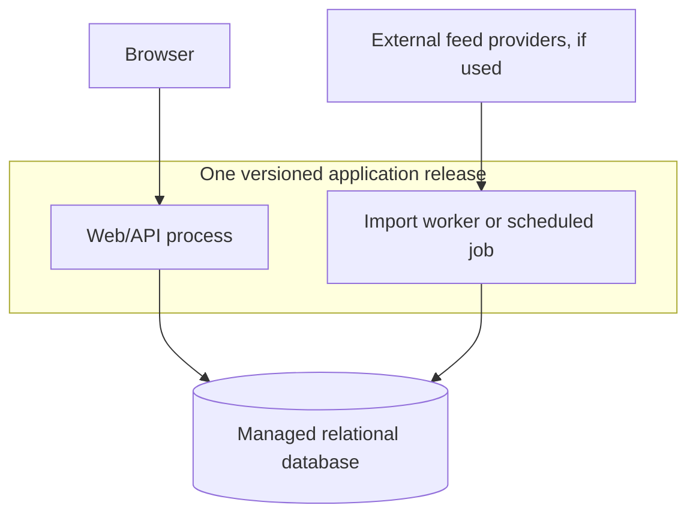

# ADR 001 — OneSport modular monolith on managed hosting

**Status:** Architecture accepted; this revision awaits student review  
**Date:** 2026-10-29  
**Requirements:** [OneSport](../Tasks/data/OneSport.txt)  
**Discussion:** [Conversation record](Task_1_Discussion_Notes.md)

## Context and drivers

OneSport combines accounts, sports news, upcoming event ticket listings, country filtering, saved collections, and friendships. The requirements do not establish a need for independently deployed services. A small initial team and manageable initial traffic are planning assumptions rather than confirmed requirements.

The design should keep development and operations straightforward, support local transactions, and preserve boundaries as the codebase grows. The introduction mentions purchasing tickets, but the stories only specify browsing and saving them. Checkout and inventory ownership remain unresolved and must not be silently added to the scope.

## Architecture decisions made now

1. **Use a modular monolith:** one application codebase, one versioned release, and five modules: Identity/Profile, News, Events/Ticket Listings, Saved Items, and Social.
2. **Use managed application hosting and a managed relational database:** reduce infrastructure administration while retaining application control of domain logic and transactions. No provider or database product is selected by this ADR.
3. **Enforce module ownership:** each module owns its domain behavior and persistence access. Other modules use explicit interfaces rather than its internal classes or tables. Concrete rules appear below.
4. **Keep relational transactions available for correctness:** multi-step changes such as accepting a friend request must not leave contradictory state. Workflows spanning modules may coordinate their public operations in a shared transaction.
5. **Separate background ingestion from interactive requests:** if external feeds are used, execute imports in a background process or scheduled job built from the same release. Do not perform long-running imports inside browser requests. This is process separation within the application, not a separately owned service.

## Module ownership and enforcement

| Module | Stories | Owns |
|---|---|---|
| Identity/Profile | 1–6 | Accounts, credentials, sessions, profile changes and account lifecycle |
| News | 7–8 | Article metadata, source identifiers, news queries and country filtering |
| Events/Ticket Listings | 11–12 | Events, offers, validity metadata, listing queries and country filtering |
| Saved Items | 9–10,13–15,20–21 | Saved news/ticket relationships and add/remove/list/clear operations |
| Social | 16–19,22–24 | Friend requests, friendships and their state transitions |

Email lookup belongs to Identity/Profile; Social uses that module's permitted user-lookup interface for story 19. Social owns the relationship behavior, not a duplicate user directory.

Enforce these rules during implementation:

- **Public entry points only:** expose each module's supported operations and data-transfer types through a public interface/package. Another module must not import its internal services, ORM entities, repositories, or provider adapters.
- **Owner-only persistence access:** a module reads and writes its owned tables through its own persistence code. Cross-module SQL joins and direct table access are prohibited by default; request data through the owning module's query interface. A shared database does not make every table public.
- **Explicit workflow coordination:** an application-level workflow can call several modules' public operations and supply a shared transaction context. For example, account deletion calls Identity, Saved Items, and Social cleanup operations; it must not bypass them with arbitrary SQL. Transaction completion belongs to the workflow, not a hidden commit inside each called module.
- **Controlled dependencies:** document permitted module dependencies and keep them acyclic. Shared code may contain small technical utilities and stable identifiers, but must not become a collection of unrelated business rules.
- **Owned migrations:** every table and migration has a module owner. Changes to a public interface or a cross-module foreign key require review of affected callers. Database cascades must be reviewed explicitly so they do not silently bypass required domain behavior.
- **Automated and review enforcement:** configure architecture checks in CI to reject forbidden imports and dependency cycles. Include module ownership and persistence access in code-review criteria, and add integration checks for critical transactions and authorization. These are implementation requirements; this ADR does not claim that code or checks already exist.

Language-specific package boundaries, the precise dependency map, and the CI tool are chosen when the codebase is implemented. Exceptions require an explicit rationale and review rather than an informal bypass.

## Deployment structure

“One application” means one codebase and coordinated release lifecycle; it does not require every task to run in one operating-system process.

| Runtime component | Responsibility | Release relationship |
|---|---|---|
| Web/API process | Serve browser requests and execute module operations | Runs the selected application release |
| Import worker or scheduled job, if feeds are confirmed | Fetch/import external news and ticket information using the owning modules' operations | Uses the same application release with a different entry point |
| Managed relational database | Persist module-owned data and support transactions | Schema evolves through coordinated application migrations |

The web process and worker are packaged from the same versioned source/release artifact. The platform may run them as separate processes, containers, or scheduled jobs. They can have different resource allocations or replica counts without becoming independently released microservices.

The worker invokes News and Events/Ticket Listings code in its own process; it does not call the web process merely to reuse domain logic. Both runtimes connect to the same logical database and follow the same ownership rules. Web access must never depend on an import completing successfully.

This diagram shows runtime components; both application entry points use the same modular codebase. Ingestion is optional until data sources are confirmed. A persistent queue is not mandated: a scheduled import may suffice. Select scheduling and delivery machinery after establishing import frequency, duration, and reliability needs.

Release web and worker code together, execute migrations through a controlled release step, and account for any overlap between old and new processes during rollout. Exact deployment tooling and rollout strategy remain open. Process separation reduces resource contention but does not eliminate shared-database or platform failures.

## Alternatives considered

| Alternative | Benefits | Costs | Outcome |
|---|---|---|---|
| Modular monolith on managed hosting | Local transactions, simple development and coordinated releases, reduced infrastructure administration | Shared release and database; boundaries need enforcement | Selected |
| Microservices | Independent ownership, deployment and scaling | Distributed consistency, service contracts, retries and greater operations burden | Rejected for the initial architecture; current requirements do not justify the cost |
| Functions with managed backend services | Managed execution and elastic capacity | Platform coupling, function limits, permissions and workflow coordination | Not selected initially; reconsider if platform or workload evidence supports it |

Serverless execution is a hosting model that can overlap with other designs. The compared alternative is a backend organized around independently invoked cloud functions and managed services. The selected platform may use serverless infrastructure internally without changing this ADR's application boundaries.

## Architecture-level correctness requirements

- User-owned data must be authorized against the authenticated user. Only the recipient may accept/refuse a friend request; self-requests are invalid.
- Accepting a request must atomically establish one friendship and update request state. Retried or concurrent operations must not create duplicates.
- Clearing saved lists must not leave the two collections partially cleared. Account deletion must revoke access and perform coordinated cleanup under an explicit retention policy.
- Saving a ticket offer records interest; it does not reserve inventory or guarantee price or availability.
- If external imports are used, repeated imports must not duplicate records. Provider failures must not corrupt stored data or block browsing. Freshness and expiry must be represented according to the eventual product policy.

These requirements constrain the design without selecting a locking algorithm, queue, authentication library, or provider-specific mechanism.

## Implementation details to finalize later

| Detail | When to decide |
|---|---|
| Language/framework, package layout, interface names and architecture-check tooling | During codebase setup, while enforcing the rules above |
| Hosting provider, database product, instance sizes and connection limits | After confirming budget, workloads and operational requirements |
| News/ticket provider adapters, import schedule, retry/backoff policy, stable external keys and queue necessity | After confirming sources, rate limits and freshness objectives |
| Credential/session libraries and configuration | Before implementing account functionality; authentication and authorization remain mandatory |
| Table schemas, indexes, uniqueness enforcement, transaction isolation and locking strategy | During persistence design; verify the stated invariants |
| Cache, pagination implementation, monitoring stack, migration and rollout tools | During implementation and operational planning, guided by measured needs |

Deferring a mechanism does not defer correctness or security. These details must be resolved before the affected functionality is released. A choice that violates the architecture decisions requires a new or superseding ADR.

## Product and operational questions requiring clarification

These are missing requirements, rather than implementation choices the development team can decide unilaterally:

1. Is ticket purchasing a vendor redirect, provider checkout, or first-party sales? Direct sales require a separate decision on inventory, reservations, payments, refunds and reconciliation before implementation.
2. Which providers and licenses apply, and how fresh must news and offers be?
3. Does country mean event location, source location, or target audience? Which countries are supported?
4. What are the rules for email lookup, profile visibility, crossed requests, and account deletion/retention?
5. What traffic, availability, latency, privacy, recovery and budget constraints apply?

## Consequences and revisit conditions

The system retains one coordinated release and a shared database. A severe application failure, migration problem, or database outage can affect several capabilities. Background process separation helps contain imports but provides incomplete fault isolation. Managed services reduce administration; the team still owns application security, configuration, monitoring, migrations, backup/recovery verification and correct data handling.

Review module boundaries continuously. Reassess the architecture if measured load requires independent scaling that simpler changes cannot meet, separate teams require independent releases, or availability objectives demand stronger isolation. Define data ownership, contracts, failure handling and operational ownership before extracting services.

## Review history

- **2026-10-29:** Student accepted the modular monolith with managed hosting after discussing alternatives and maintenance risks.
- **2026-10-29:** Student requested concrete boundary rules, clarification of the web/worker deployment, and separation of architecture decisions from implementation details. This revision adds those sections and moves provider, scheduling, library and persistence mechanisms into deferred choices. Student approval of this revision remains pending.
