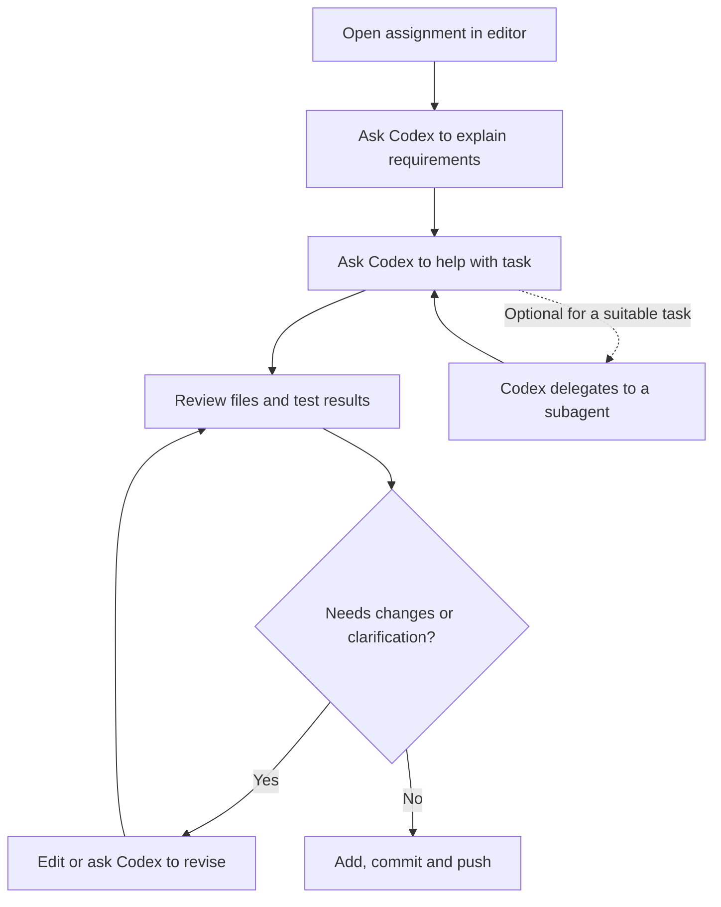

# My AI workflow — draft for personal review

For these coursework assignments, I use Codex alongside my editor. I open the task instructions and ask Codex to explain what the task requires. When I understand the goal, I ask it to help complete the task and prepare the required files or reports. I can also make changes myself, then ask Codex to polish or check them.

I review the output and ask follow-up questions or corrections when something is unclear. For example, I checked how the saved Codex profile related to the copy in the assignment folder. Codex can run checks or demonstrate a feature, and I review the results and the files before adding, committing, and pushing my work. When an assignment calls for subagents, I can ask Codex to use one for a bounded task and record the result.

This draft describes the workflow observed during these assignments. Review and adjust it to reflect your usual work, including any other tools you use, before submitting it as your personal workflow.

The same workflow is available as a standalone figure: [workflow.svg](workflow.svg).

